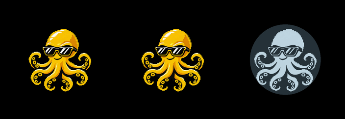

# ARTrack — záznam trajektorie (ARCore) + GPS + fotky pro fotogrammetrii

Jednoduchá Android aplikace: jedno tlačítko, které naráz nahrává

* **frames/** — plnorozlišné JPEG fotky v nastaveném intervalu (hlavní vstup do fotogrammetrie),
* **frames.csv** — ke každé fotce pozici a orientaci kamery + kalibraci + GPS,
* **pose.csv** — pózu kamery pro **každý trackovaný snímek** (celá trajektorie, AR/VIO),
* **gps.csv + track.gpx** — všechny GPS fixy během záznamu,
* **video.mp4** — volitelně záznam ARCore session (viz upozornění níže),
* **realityscan/** — `trajectory.csv` s pozicemi kamer v UTM + návod k importu,
* **meta.json** — zařízení, kalibrace kamery, počty, časové báze, report fitu.

Smysl: fotogrammetrický SW nemusí hledat pozice kamer naslepo — pro každý snímek
dostane externí orientaci (z AR trackingu, v metrech a se správným měřítkem)
a polohu v WGS84 (z GPS).

## Instalace

APK: [`apk/artrack-debug.apk`](apk/artrack-debug.apk) (v1.7) — podepsané debug klíčem,
takže v telefonu stačí povolit instalaci z neznámých zdrojů.

Požadavky:

* Android 10 (API 29) a vyšší,
* telefon [podporovaný ARCore](https://developers.google.com/ar/devices)
  + *Google Play Services for AR* (aplikace si o instalaci řekne sama),
* oprávnění kamera + přesná poloha.

## Jak to vypadá



Ikona je adaptivní s **průhledným pozadím** — maskot plave přímo na ploše, žádná
dlaždice ([na domovské obrazovce](docs/icon-on-homescreen.png)). Má popředí ve
všech pěti hustotách a monochromatickou vrstvu pro tematické ikony Androidu 13+.

Průhlednost má jeden důsledek: co přečuhuje přes masku launcheru, to se uřízne,
a bez pozadí je ten řez vidět. Kresba proto sedí v **70 ze 108 dp** — největší
velikost, při které squircle maska neukrojí nic a kolečková jen oškrábne dva
konce chapadel (0,6 % kresby). Přegenerovat jde kdykoli:

```bash
python3 tools/make_icons.py     # ze zdroje docs/icon-source.png, potřebuje pillow
```

Skript rovnou vypíše, kolik pixelů by která maska uřízla, takže změna velikosti
není hádání.

## Použití

1. Spustit, chvíli pomalu zamíchat telefonem, dokud není `tracking: TRACKING`.
2. Počkat na GPS fix (řádek `GPS:` ukáže souřadnice a přesnost).
3. **REC** → záznam. Chodit **pomalu a plynule**, bez rychlých otočení,
   objekt snímat s velkým překryvem.
4. **STOP** → aplikace dopíše CSV a přesune celou složku do cílové složky —
   výchozí je `Download/ARTrack/<datum_čas>/`, nebo kam si nastavíš (viz níž).

Přepínače (vpravo nahoře, nastavují se před spuštěním záznamu):

| přepínač | význam |
|---|---|
| **Foto: 0,25 / 0,5 / 1 / 2 s / vypnuto** | interval ukládání plnorozlišných JPEG (výchozí 0,5 s) |
| **Video (VGA)** | zapne i záznam MP4 přes ARCore (výchozí zapnuto) |
| **Autofocus** | vypnutý (výchozí) = fixní zaostření a tedy konstantní ohnisko pro celou sérii; zapnutý ostří průběžně, ale `fx/fy` se mění snímek po snímku (proto je kalibrace u každého řádku CSV) |
| **chip se složkou** (vpravo nahoře) | kam se záznam uloží — tapnutím vybereš vlastní složku, nebo se vrátíš na výchozí `Download/ARTrack` |

### Kam se to ukládá

Tlačítko **Cíl** otevře systémový výběr složky (Storage Access Framework), takže
jde zvolit cokoli, co má zapisovatelný poskytovatel: interní úložiště, **SD karta**,
USB flash přes OTG i cloudová složka (Drive, Dropbox…). Oprávnění ke složce se
drží trvale, takže se vybírá jednou; když ho systém po reinstalaci nebo odebrání
práv zahodí, appka to napíše a spadne zpátky na `Download/ARTrack`.

Záznam se uloží jako podsložka `<datum_čas>/` přímo ve vybrané složce (žádná
mezivrstva `ARTrack/`). Dokud se celý přenos nepovede, kopie zůstává v privátní
složce aplikace a chybová zpráva řekne kde — nic se nemaže dřív, než je venku.

Cloudová složka má jeden háček: nahrává se přes poskytovatele, takže je to
pomalejší a při slabém signálu to může selhat. Na stovky fotek je spolehlivější
uložit lokálně a nasdílet potom.

Záznam se sám ukončí, když aplikaci přepneš do pozadí.

## ⚠️ Video je jen referenční, fotky jsou ostrá data

ARCore nahrává MP4 **ve VGA (640×480) při 5 Mbps** — to je dané knihovnou,
ne nastavením aplikace (viz dokumentace `Session.startRecording()`). Na
fotogrammetrii je to málo, takže aplikace vedle videa ukládá **plnorozlišné
JPEG** z CPU streamu kamery, typicky **1920×1080** (ARCore nedává víc; strop
je rozlišení GPU textury). Každá fotka má v `frames.csv` svou pózu, takže
z videa nic řezat nemusíš — ale můžeš, mapování indexů je popsané níž.

Pokud by bylo potřeba **plné rozlišení senzoru** (12 Mpx a výš), musel by se
záznam přepsat na ARCore *shared camera* + Camera2 JPEG capture. To je jiná
liga složitosti; tady vědomě není.

## Výstupní soubory

`frames.csv` — jeden řádek na jednu uloženou fotku:

| sloupec | význam |
|---|---|
| `image_name` | soubor ve `frames/` |
| `frame_index` | index odpovídajícího řádku v `pose.csv` |
| `t_rel_s` | čas od prvního snímku záznamu [s] |
| `timestamp_ns` | původní časová značka kamery [ns] |
| `tx, ty, tz` | pozice kamery ve světovém systému ARCore [m] |
| `qx, qy, qz, qw` | orientace kamery jako kvaternion (camera → world) |
| `tracking_state` | `TRACKING` / `PAUSED` / `STOPPED` — ber jen `TRACKING` |
| `fx, fy, cx, cy` | kalibrace **této fotky** [px] |
| `width, height` | rozměr fotky [px] |
| `lat, lon, alt_m` | poslední známý GPS fix (WGS84, výška nad elipsoidem) |
| `gps_acc_m`, `gps_age_ms` | přesnost fixu a jak byl starý |

`pose.csv` má stejné sloupce pro **každý** trackovaný snímek (celá trajektorie),
jen `fx,fy,cx,cy` patří video streamu, ne fotkám.

**Pozor na `frame_index` u videa:** je to pořadí zalogovaných snímků, ne pořadí
snímků ve videu. Při ukládání fotky render thread pár snímků kamery zahodí
(kolik, hlásí `frames_skipped_estimate` v `meta.json`), takže k videu se páruj
přes **`t_rel_s`**, což je čas snímku od začátku záznamu — index může po první
fotce odskočit.

**Konvence:** póza je *camera-to-world*, osy kamery +X vpravo, +Y vzhůru,
−Z dopředu (OpenGL styl). Jde o `Camera.getPose()`, tedy pózu fyzické kamery,
kde „vpravo/vzhůru“ je vztažené k **readoutu obrazu**, ne k displeji — póza
tedy odpovídá uloženým fotkám bez ohledu na to, jak jsi telefon držel
(JPEG se ukládají neotočené, v orientaci senzoru, bez EXIF).
Počátek světa = místo startu session, +Y je svisle vzhůru (podle gravitace),
azimut je **libovolný** — ARCore není orientovaný na sever, georeferencuj z GPS.

`gps.csv` má u každého fixu `t_rel_s_approx` = čas záznamu v okamžiku příchodu
fixu (±1 snímek), takže GPS a snímky jdou spárovat bez řešení hodinových bází.

Složka záznamu dostane i vlastní `README.txt` s popisem sloupců — data jsou
samovysvětlující i po roce.

## Import do RealityScan (Epic Games)

Výstup z telefonu je **rovnou importovatelný balíček** — nic se na PC
nedopočítává (v cílové složce, výchozí `Download/ARTrack/`):

```
20261127_143512/
├── frames/              fotky v plném rozlišení, GPS zapsané přímo v EXIFu
├── realityscan/
│   ├── trajectory.csv          pozice kamer name,x,y,z v UTM (podle GPS)
│   ├── trajectory_space.txt    totéž oddělené mezerami (fallback importu)
│   ├── trajectory_local.csv    pozice v lokálních metrech, bez georeferencování
│   └── jak-importovat.txt      postup + report fitu AR → mapa
├── frames.csv, pose.csv, gps.csv, track.gpx, meta.json, README.txt
└── video.mp4            (volitelně)
```

Postup (cesta A, doporučená):

1. Nastav souřadnicový systém projektu na EPSG, který je v `jak-importovat.txt`
   (např. `32633` = UTM 33N) — **před** importem trajektorie.
2. Načti fotky z `frames/`.
3. *WORKFLOW → Import Metadata → **Trajectory*** (ve starších verzích *Flight log*),
   vyber `realityscan/trajectory.csv`, popis sloupců `name x y z`.
4. V nastavení alignmentu **zapni camera priors (position prior)**.
5. Align Images.

Past: když popis sloupců nesedí souboru, import neohlásí chybu, jen sloupce
zahodí — po importu zkontroluj u pár kamer, že mají prior pozici.

Cesta B je ještě jednodušší: fotky mají GPS v EXIFu, takže se dají načíst samy
a RealityScan si polohy vezme odtud. Měřítko pak ale drží jen GPS (metry), ne AR
trasa (centimetry). Obě cesty jdou kombinovat.

Rotace se neimportují: přesnou konvenci omega/phi/kappa v RealityScanu jsem
neměl z čeho ověřit a špatná rotace je horší než žádná. Orientace si alignment
spočítá sám.

### Co je v EXIFu

GPS (lat/lon/alt, WGS84), čas pořízení, výrobce a model telefonu, ohnisko
v ekvivalentu 35 mm a orientace = 1 (fotka se nikde nemá otáčet). Píše se při
ukládání snímku; `meta.json` hlásí `photos_without_exif`, kdyby zápis selhal.

### Jak se dělá transformace AR → mapa

AR trajektorie je v metrech, ale azimut má libovolný (ARCore nemá kompas).
Z GPS fixů se proto odhadne **jen otočení kolem svislé osy a posun, měřítko
zůstává 1** — AR měřítko je o dva řády lepší než GPS. Do `jak-importovat.txt`
a `meta.json` se zapíše RMS fitu a **nejistota azimutu** (≈ RMS / délka trasy):

* obchůzka ~4 m → azimut ±40°, ale pozice kamer do ~1 m,
* trasa ~40 m → azimut ±4°.

Když nejistota přeleze ±25°, appka azimut označí jako **neurčitelný**
(`heading_reliable: false` v `meta.json`) místo aby tvářila číslo jako výsledek.
Ušlou vzdálenost vidíš živě ve stavové kartě a v `meta.json` jako
`track_length_m`, takže poznáš hned při záznamu, jestli se fit chytne.

Když jsou GPS fixy nepoužitelné (méně než dva s přesností ≤ 20 m), balíček se
zapíše jen v lokálních metrech a napíše to. Potřebuješ-li model správně otočený
k severu z krátké trasy, použij `trajectory_local.csv` a otoč to v GISu, nebo
zadej azimut ručně v Python exportu (`--heading`).

Ověřeno: převod WGS84 → UTM souhlasí s `pyproj` do 0,5 mm (6 míst, obě
polokoule), fit na bezšumových datech vrátí zadaný azimut (RMS 0,00 m) a při
2 m šumu GPS a 60 m trase drží pozice do ~1,2 m od pravdy.

## Co navíc umí Python export

`tools/artrack_export.py` dělá to, co se do telefonu nehodí:

```bash
python3 tools/artrack_export.py <session>              # COLMAP + RealityScan + geo CSV
python3 tools/artrack_export.py <session> --heading 137 # azimut ručně
python3 tools/artrack_export.py <session> --epsg 32633  # konkrétní EPSG
python3 tools/artrack_export.py <session> --xmp         # XMP sidecary s rotacemi
python3 tools/artrack_export.py <session> --from-video --step 10
```

* `colmap/cameras.txt`, `images.txt`, `points3D.txt` — pózy v konvenci COLMAP,
* `frames_geo.csv` — WGS84 + lokální AR souřadnice ke každé fotce,
* `xmp/*.xmp` — **experimentální** XMP sidecary s plnou pózou; konvenci matice
  `xcr:Rotation` jsem neověřil, takže to zkus na 10 fotkách a při zrcadleném
  výsledku přidej `--xmp-transpose`,
* řezání snímků z videa, když chceš jít přes `video.mp4`.

Ruční řezání videa se stejným mapováním indexů:

```bash
ffmpeg -i video.mp4 -vf "select='not(mod(n\,10))'" -vsync 0 -q:v 2 frame_%06d.jpg
# n-tý vyříznutý obrázek odpovídá řádku pose.csv s frame_index = n*10
```

## Co aplikace *nedělá*

* Nepřepočítává AR trajektorii do S-JTSK ani ENU — v CSV jsou lokální metry
  vedle WGS84; transformaci (Helmert z GPS fixů) si udělej v GIS.
* Nepoužívá ARCore Geospatial API (globální póza z VPS), které by dalo řádově
  lepší georeferencování — vyžaduje API klíč a připojení.
* Neposkytuje model distorze objektivu; `fx,fy,cx,cy` jsou jen pinhole prior,
  zbytek nech dopočítat fotogrammetrickému SW.
* Neřeší expozici, ISO ani vyvážení bílé — bere, co dá ARCore.

## Přesnost, na kterou se dá počítat

ARCore VIO drží řádově **1–2 % ujdené vzdálenosti** při plynulém pohybu —
jednotky centimetrů na krátkou obchůzku, desítky centimetrů na delší trasu;
při rychlém pohybu, v šeru nebo nad málo texturovaným povrchem driftuje víc
(hlídej `tracking_state`). GPS z telefonu je ±3–10 m horizontálně a výrazně
hůř ve výšce — slouží k umístění modelu do mapy, ne k jeho měřítku. Měřítko
(to podstatné) drží AR trajektorie.

## Build ze zdrojů

```bash
cd android/artrack
echo "sdk.dir=/cesta/k/Android/sdk" > local.properties
./gradlew :app:assembleDebug     # app/build/outputs/apk/debug/app-debug.apk
```

ARTrack 1.7 (versionCode 8). AGP 8.13.2, Kotlin 2.1.21, compileSdk 36,
ARCore 1.57.0, androidx.exifinterface 1.4.2, androidx.documentfile 1.1.0, minSdk 29.
Testovací (ne runtime) závislost: Robolectric 4.18.1 pro render overlaye.
Kód je v `app/src/main/java/cz/tsk/artrack/` — bez frameworků, 14 souborů:

| soubor | role |
|---|---|
| `MainActivity.kt` | lifecycle, ARCore session, start/stop záznamu, UI |
| `SessionRecorder.kt` | zápis `frames.csv`, `pose.csv`, `gps.csv`, `track.gpx`, `meta.json` |
| `StillCapturer.kt` | JPEG komprese na worker threadu + zápis EXIFu |
| `RealityScanPackage.kt` | `trajectory.csv` a `jak-importovat.txt` |
| `Geo.kt` | WGS84 → UTM a fit azimutu AR trajektorie z GPS |
| `YuvUtil.kt`, `YuvPlanes.kt` | YUV_420_888 → NV21 (kopie na render threadu, převod na workeru) |
| `LocationTracker.kt` | fused location provider |
| `Exporter.kt` | přesun složky do vybrané složky (SAF) nebo do `Download/` (MediaStore) |
| `ShutterButton.kt`, `SegmentedControl.kt`, `ActionSheet.kt` | vlastní iOS-like ovládací prvky |
| `BackgroundRenderer.kt`, `ShaderUtil.kt`, `DisplayRotationHelper.kt` | hledáček |
